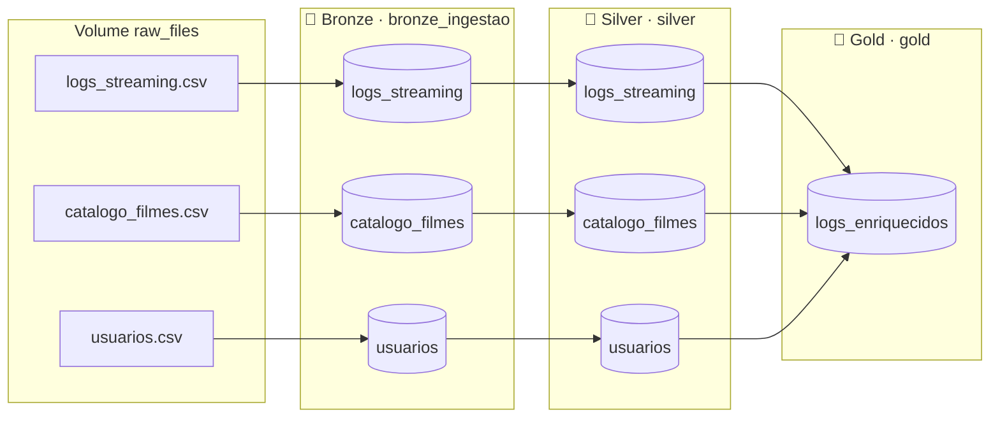

# Streaming Dev — Pipeline de Dados com Arquitetura Medalhão


Pipeline de dados end-to-end de uma plataforma de streaming, construído no **Databricks** com **PySpark**, **Delta Lake** e **Unity Catalog**, seguindo a **arquitetura medalhão** (bronze → silver → gold).

O projeto transforma arquivos CSV brutos e inconsistentes em uma tabela analítica confiável, pronta para consumo por times de análise e BI.

---

## Sumário

- [Visão geral](#visão-geral)
- [Arquitetura](#arquitetura)
- [Fontes de dados](#fontes-de-dados)
- [Estrutura do projeto](#estrutura-do-projeto)
- [Camadas](#camadas)
  - [Bronze](#-bronze--ingestão)
  - [Silver](#-silver--limpeza-e-padronização)
  - [Gold](#-gold--enriquecimento-e-agregação)
- [Decisões de design e boas práticas](#decisões-de-design-e-boas-práticas)
- [Stack tecnológica](#stack-tecnológica)
- [Como executar](#como-executar)
- [Autor](#autor)

---

## Visão geral

O pipeline processa três fontes de dados — **logs de visualização**, **catálogo de filmes** e **cadastro de usuários** — em camadas progressivas de qualidade:

| Camada | Objetivo | Resultado |
| --- | --- | --- |
| 🥉 **Bronze** | Ingerir os dados exatamente como chegam, com rastreabilidade | 3 tabelas brutas |
| 🥈 **Silver** | Limpar, padronizar e tipar os dados | 3 tabelas limpas |
| 🥇 **Gold** | Enriquecer e agregar para análise e BI | 1 tabela analítica |

## Arquitetura



Todas as camadas vivem no catálogo `streaming_dev`, governado pelo Unity Catalog.

## Fontes de dados

| Arquivo | Conteúdo | Linhas (bronze) |
| --- | --- | ---: |
| `logs_streaming.csv` | Logs de visualização (sessões de reprodução) | 1.007 |
| `catalogo_filmes.csv` | Catálogo de filmes | 62 |
| `usuarios.csv` | Cadastro de usuários | 82 |

Os arquivos ficam no volume `streaming_dev.bronze_ingestao.raw_files`.

## Estrutura do projeto

| Asset | Tipo | Responsabilidade |
| --- | --- | --- |
| `inicio` | Notebook | Setup do catálogo, schemas e volume + ingestão da camada bronze |
| `silver` | Notebook | Limpeza, padronização e gravação das tabelas silver |
| `gold` | Notebook | Agregações, enriquecimento (joins) e gravação da tabela gold |
| `streaming_dev.bronze_ingestao.raw_files` | Volume | CSVs brutos de origem |

---

## Camadas

### 🥉 Bronze — Ingestão

**Schema:** `streaming_dev.bronze_ingestao` · **Notebook:** `inicio`

- Criação do catálogo `streaming_dev` e dos schemas `bronze_ingestao`, `silver` e `gold`, todos com comentários descritivos.
- Criação do volume `raw_files`, que armazena os CSVs de origem.
- Função `ingest_bronze()`: lê cada CSV (com as opções `multiLine` e `escape`) e grava a tabela bronze correspondente.
- **Rastreabilidade:** cada registro recebe as colunas `ingest_timestamp` (quando foi ingerido) e `source_file` (de qual arquivo veio).

| Tabela | Linhas |
| --- | ---: |
| `logs_streaming` | 1.007 |
| `catalogo_filmes` | 62 |
| `usuarios` | 82 |

### 🥈 Silver — Limpeza e padronização

**Schema:** `streaming_dev.silver` · **Notebook:** `silver`

Lê as tabelas bronze com `spark.table()` e grava tabelas Delta gerenciadas com o mesmo nome, mantendo as colunas de rastreabilidade.

As transformações seguem o princípio de **uma função por DataFrame** (`transformar_logs`, `transformar_catalogo`, `transformar_usuarios`), compostas a partir de helpers reutilizáveis:

| Helper | O que faz | Exemplo |
| --- | --- | --- |
| `padronizar_data(df, coluna, formatos)` | Converte strings para `date` testando múltiplos formatos com `coalesce` de `try_to_date`; valores inválidos viram `null` | `signup_date` chega em `yyyy-MM-dd`, `MM-dd-yyyy` e `dd/MM/yyyy` |
| `padronizar_texto(df, coluna)` | Minúsculas, sem espaços, hífens ou underscores; aplicado em `content_type` e `subscription_type` | `Smart_TV` → `smarttv` |
| `padronizar_generos` / `padronizar_paises` | Lookup via `create_map`; valores não mapeados permanecem inalterados | `Terror` → `Horror`; `BR` / `Brasil` → `Brazil` |
| `padronizar_devices` | Converte para as formas canônicas | `mobile` → `Mobile`; `smart tv` → `Smart TV` |

**Tratamentos específicos da tabela de logs:**

- `playback_status` convertido para minúsculas.
- `watch_time_minutes` convertido com `try_cast`, tratando valores sujos como `'zero'`.
- Colunas calculadas:
  - `watch_time_hours`
  - `watch_categories`, classificando a sessão pelo tempo assistido:

| Categoria | Critério |
| --- | --- |
| Curto | menos de 120 min |
| Longo | de 120 a 180 min |
| Muito longo | mais de 180 min |

**Gravação:** `mode("overwrite")` + `option("overwriteSchema", "true")`.

### 🥇 Gold — Enriquecimento e agregação

**Schema:** `streaming_dev.gold` · **Notebook:** `gold`

**Agregações:** lê as tabelas silver com `spark.table()` e produz métricas por `subscription_type` e `country` (número de sessões, média e total de minutos assistidos).

**Enriquecimento:** `logs ⋈ catálogo` (chave `movie_id`) `⋈ usuários` (chave `user_id`), ambos com `left join`.

- Colunas de usuário que colidem com as dos logs são renomeadas (`user_country`, `user_subscription_type`) para evitar ambiguidade.
- As colunas de rastreabilidade (`ingest_timestamp` e `source_file`) são descartadas dos três lados antes dos joins; a rastreabilidade por origem permanece nas camadas bronze e silver.

**Tabela final:** `streaming_dev.gold.logs_enriquecidos` — Delta gerenciada, com 23 colunas contendo apenas dados de negócio.

---

## Decisões de design e boas práticas

| Prática | Como foi aplicada |
| --- | --- |
| **Arquitetura medalhão** | Responsabilidade clara por camada: bruto → tratado → analisável |
| **Fonte única de ingestão** | O volume `raw_files` é lido apenas pelo notebook `inicio`; o silver consome as tabelas bronze |
| **Tabelas Delta gerenciadas** | ACID, time travel, evolução de schema e consulta via SQL no Unity Catalog, em vez de arquivos Parquet soltos |
| **Funções puras e reutilizáveis** | Recebem e retornam DataFrames, componíveis com `.transform()` |
| **Uma função por DataFrame** | Sem ramificações frágeis por presença de colunas |
| **Robustez contra dados sujos** | `try_to_date` e `try_cast` produzem `null` em vez de quebrar o pipeline |
| **Configuração fora da lógica** | Thresholds e mapeamentos declarados como constantes no topo do notebook |
| **Rastreabilidade** | `ingest_timestamp` e `source_file` indicam quando e de qual arquivo cada dado veio; são criadas na bronze e persistem até a silver |
| **Nomenclatura e estilo consistentes** | Prefixos `padronizar_*` e `transformar_*`, type hints e docstrings em todas as funções |
| **Prevenção de ambiguidade em joins** | Colunas duplicadas renomeadas antes de unir |
| **Idempotência** | Gravação com `overwrite`: reexecutar um notebook refaz as tabelas da camada sem duplicar dados |

## Stack tecnológica

- **Plataforma:** Databricks
- **Processamento:** PySpark / Spark SQL
- **Armazenamento:** Delta Lake
- **Governança:** Unity Catalog (catálogo, schemas e volumes)
- **Padrão arquitetural:** Medallion Architecture

## Como executar

### Pré-requisitos

- Workspace Databricks com **Unity Catalog** habilitado.
- Permissão para criar catálogo, schemas e volumes.
- Compute com runtime recente do Databricks (necessário para `try_to_date` e `try_cast`).
- Os três arquivos CSV de origem.

### Passo a passo

| # | Notebook | O que faz |
| :-: | --- | --- |
| 1 | `inicio` | Cria catálogo, schemas e volume; ingere os CSVs na camada bronze |
| 2 | `silver` | Transforma os dados e grava as tabelas silver |
| 3 | `gold` | Agrega, enriquece e grava `streaming_dev.gold.logs_enriquecidos` |

> **Atenção:** o notebook `inicio` cria o volume `raw_files`. Se ele ainda não contiver os CSVs, faça o upload dos três arquivos antes da etapa de ingestão.

Execute os notebooks **em ordem**. Reexecutar qualquer um deles refaz as tabelas da sua camada (gravação com `overwrite`).

### Consultando o resultado

```sql
SELECT * FROM streaming_dev.gold.logs_enriquecidos LIMIT 10;
```

---

## Autor

**Paulo Roberto Albuquerque**
Analista de Sistemas / Dados · em transição para Engenharia de Dados

